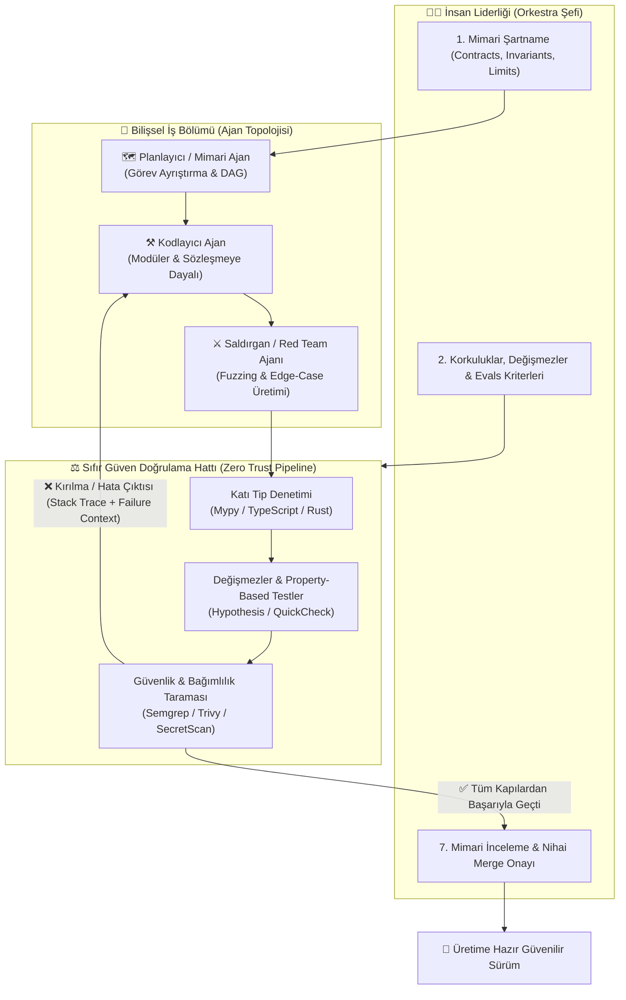

# Yapay Zekâ Çağında Mühendislik: Kod Hamallığından Sistem Orkestrasyonuna

[](LICENSE)
[](CONTRIBUTING.md)
[](README.md)
[](docs/12-orkestrasyon-yasasi.md)
[](#-katkıda-bulunma-ve-topluluk)

---

## 🏛️ Devlerin Kürsüsü: Büyük Zihinlerin İkazları

> *"En popüler yeni programlama dili artık İngilizcedir."*  
> — **Andrej Karpathy** (OpenAI Kurucu Ortağı, Eski Tesla AI Direktörü)

> *"Gelecekte geleneksel anlamda kod yazan yazılım mühendisleri olmayacak; sistem koreografları ve yazılım orkestra şefleri olacak."*  
> — **Jensen Huang** (NVIDIA CEO)

> *"Yazılımın asıl zorluğu hiçbir zaman kod yazmak olmadı; asıl zorluk her zaman neyin inşa edilmesi gerektiğini tam, tutarlı ve eksiksiz olarak kavrayabilmekti."*  
> — **Fred Brooks** (The Mythical Man-Month Yazarı, Turing Ödülü Sahibi)

> *"Eğer elinizde biçimsel ve kesin bir şartname (specification) yoksa, yazdığınız her kod satırı özünde potansiyel bir hatadır (bug)."*  
> — **Leslie Lamport** (TLA+ Yaratıcısı, Dağıtık Sistemler Öncüsü, Turing Ödülü Sahibi)

> *"Basitlik, güvenilirliğin ön koşuludur. Test etmek bir sistemde hataların varlığını gösterebilir; fakat hataların yokluğunu asla kanıtlayamaz."*  
> — **Edsger W. Dijkstra** (Bilgisayar Biliminin Kurucularından, Turing Ödülü Sahibi)

> *"Kötü programcılar kod için endişelenir. İyi programcılar ise veri yapıları ve bunların arasındaki ilişkiler için kafa yorar."*  
> — **Linus Torvalds** (Linux ve Git Yaratıcısı)

> *"Bir yazılım tasarımı inşa etmenin iki yolu vardır: Biri o kadar basit yapmaktır ki bariz hiçbir kusur bulunamasın. Diğeri ise o kadar karmaşık yapmaktır ki ortada bariz hiçbir kusur görünmesin. İlk yöntem kıyaslanamaz derecede daha zordur."*  
> — **C.A.R. Hoare** (Quicksort Yaratıcısı, Turing Ödülü Sahibi)

> *"Gününüzü yapay zekânın parantezi doğru kapatıp kapatmadığını denetlemekle geçiriyorsanız, yapay zekâyı bir kaldıraç olarak kullanmıyorsunuz demektir; onun çıraklığını ve ameleliğini yapıyorsunuzdur."*

> *"Kod yazmak nihai amaç değil, sistem inşasının kaçınılmaz bir yan etkisidir. Mühendislik; araçların hamallığını yapmak değil, sistem karmaşıklığını evcilleştirebilme sanatıdır."*

---

## 🧭 İçindekiler

1. [Manifesto ve Çıkış Noktası](#-manifesto-ve-çıkış-noktası)
2. [Büyük İllüzyon: "Vibe Coding" ve Stokastik Maymun Tuzağı](#-büyük-illüzyon-vibe-coding-ve-stokastik-maymun-tuzağı)
3. [Tarihsel Diyalektik: Bir Soyutlama Katmanı Daha Yükseldik](#-tarihsel-diyalektik-bir-soyutlama-katmanı-daha-yükseldik)
4. [Üç Çağın Karşılaştırma Matrisi](#-üç-çağın-karşılaştırma-matrisi)
5. [Orkestra Şefinin 8 Mimari Sütunu](#-orkestra-şefinin-8-mimari-sütunu)
6. [12 Orkestrasyon Yasası (The 12 Laws)](#-12-orkestrasyon-yasası-amentü)
7. [Uçtan Uca Orkestrasyon Topolojisi (Mermaid)](#-uçtan-uca-orkestrasyon-topolojisi)
8. [Mühendisin Yeni Yetkinlik Anatomisi](#-mühendisin-yeni-yetkinlik-anatomisi)
9. [Pratik Vaka Analizi: Çırak vs. Orkestra Şefi](#-pratik-vaka-analizi-çırak-vs-orkestra-şefi)
10. [Modern Orkestratörün Araç Kutusu](#-modern-orkestratörün-araç-kutusu)
11. [Ne Yapmalı, Neyi Bırakmalı?](#-ne-yapmalı-neyi-bırakmalı)
12. [Klasikler ve Başvuru Kitaplığı](#-klasikler-ve-başvuru-kitaplığı)
13. [Depo Mimarisi ve Şablonlar](#-depo-mimarisi-ve-şablonlar)
14. [Katkıda Bulunma ve Topluluk](#-katkıda-bulunma-ve-topluluk)

---

## 🎯 Manifesto ve Çıkış Noktası

Yapay zekâ modelleri kod tamamlama, fonksiyon üretme, dokümantasyon yazma ve hata ayıklama süreçlerini insan hızının katbekat ötesine taşımıştır. Bu eşik, yazılım dünyasında son 40 yılın en radikal paradigma değişimine işaret eder.

Ancak bu dönüşüm beraberinde büyük bir yanılgı doğurmuştur:  
Milyonlarca geliştirici, yapay zekâyı bir mimari kaldıraç olarak kullanmak yerine; **modelin arkasından dökülen kod kırıntılarını temizleyen, sentaks hatalarını elle düzelten ve saatlerce prompt satrancı oynayan birer dijital redaktöre, yani "AI Çırağına" dönüşmüştür.**

**Bizim Savunumuz:**  
- **Kod ucuzlamıştır; sıfır marjinal maliyete doğru koşmaktadır.** Bir şeyin üretimi sonsuz derecede ucuzladığında, değer kodun kendisine değil; **sistemin sınırlarına, veri tutarlılığına, değişmezlerine (invariants) ve doğrulama mekanizmalarına** kayar.
- **Yazılım mühendisinin yeni rolü satır satır kod dizmek değil; modelleri, test mekanizmalarını, güvenlik hatlarını ve veri akışlarını yukarıdan yöneten bir Orkestra Şefi olmaktır.**
- **Gelecek; en hızlı prompt yazanların değil, en acımasız deterministik doğrulama hatlarını kuran mimarların elinde şekillenecektir.**

---

## 🧱 Büyük İllüzyon: "Vibe Coding" ve Stokastik Maymun Tuzağı

Son dönemde popülerleşen *"Vibe Coding"* (içine doğduğu gibi prompt verip çıkan kodu kurcalamadan çalıştırma) yaklaşımı, prototipleme için eğlenceli olsa da profesyonel sistem inşası için ölümcül bir kumardır:

```
┌──────────────┐      ┌─────────────────┐      ┌─────────────────┐      ┌───────────────┐
│  Prompt Ver  │ ───► │  Yüzlerce Satır │ ───► │ Gözle / Yüzeysel│ ───► │   Gizli Hata   │
│ (Serbest Metin│     │   Stokastik Kod │      │  "Çalışıyor"    │      │  (Concurrency,│
└──────────────┘      └─────────────────┘      └─────────────────┘      │   Edge-Case)  │
       ▲                                                                        │
       └────────────────── [Prompt İle Saatlerce Yamamaya Çalış] ───────────────┘
```

### Bu Tuzağın Anatomisi:
1. **Olasılıksal Doğanın İnkarı:** Büyük Dil Modelleri (LLM'ler) birer muhakeme motoru değil, devasa istatistiksel ilişki ağlarıdır (stochastic pattern matchers). Onlara deterministik kısıtlar ve matematiksel sınırlar vermediğiniz sürece, size *"doğru görünen ama ölümcül kusurlar barındıran"* halüsinasyonlar satarlar.
2. **Doğrulama Darboğazı (The Verification Bottleneck):** 5 saniyede üretilen 500 satırlık kodu okumak, anlamak ve gizli bir race-condition olup olmadığını zihinde canlandırmak, o kodu sıfırdan tasarlamaktan daha fazla bilişsel yük yaratır.
3. **Eskimeye Mahkum Zanaat:** Bir modelin parametrik sapmalarına göre *"prompt cambazlığı"* öğrenmek, 1 yıl sonra o model güncellendiğinde çöpe gidecek bir ameleliktir. Mühendis, geçici model huylarına değil; evrensel sistem prensiplerine odaklanmalıdır.

> *"Bütün vaktini çekiç kullanmayı öğrenmeye harcarsan, bina inşa etmeyi asla öğrenemezsin."*

---

## ⏳ Tarihsel Diyalektik: Bir Soyutlama Katmanı Daha Yükseldik

Yazılım mühendisliği tarihi, **insanın makineye yaklaşması değil; makinenin insanın soyutlama seviyesine çekilmesi** tarihidir:

```
[1950'ler] Delikli Kartlar & Makine Dili (Opcode) ➔ 1:1 Donanım Bağımlılığı
    │
[1960'lar] Assembly Dili ➔ Sembolik İsimlendirme, Düşük Düzey Kontrol
    │
[1970-80] Yapısal Diller (C, Pascal, Fortran) ➔ Bellek ve Fonksiyonel Soyutlama
    │
[1990-00] Nesne Yönelimli Diller & Sanal Makineler (Java, C#, Python) ➔ Bellek Yönetiminin Devri
    │
[2010'lar] Bulut & Konteyner Çağı (Docker, K8s, Terraform) ➔ Altyapının Kod Olarak Soyutlanması
    │
[2025+]   YAPAY ZEKÂ ÇAĞI (Spesifikasyon, Ajanlar, Deterministik Evals) ➔ KODLAMANIN SOYUTLANMASI
```

Bugün nasıl kimse bir web sunucusu yazarken CPU register'larına `MOV EAX, EBX` yazmıyorsa; yarın da hiçbir mühendis rutin CRUD işlemlerini, API çağrılarını veya veri dönüşüm fonksiyonlarını elle yazmayacaktır.  
**Kod, derleyicinin ürettiği ara bayt-kod (bytecode) gibi bir yan ürün haline gelmiştir.** Mühendisin konuştuğu seviye artık doğrudan **Sistem Mimarisi ve Spesifikasyon** düzeyidir.

---

## 🎼 Üç Çağın Karşılaştırma Matrisi

| Kriter | Geleneksel Geliştirici (Klasik Dönem) | AI Çırağı / Vibe Coder (Geçiş Dönemi) | Orkestra Şefi / Sistem Mimarı (Yeni Çağ) |
| :--- | :--- | :--- | :--- |
| **Ana Üretim Aracı** | Klavye, IDE, StackOverflow, Dokümantasyon | Serbest Chat Arayüzü, Rastgele Prompt | Biçimsel Şartnameler, Ajan Hatları, Eval Suitleri |
| **Zihinsel Odak** | Dil sentaksı, kütüphane API'ları, algoritma yazımı | Modelin çıktısını okuyup elle yamamak | Sistem sınırları, veri akışı, invariant'lar, hata modları |
| **Doğrulama Felsefesi** | Manuel debug + Sonradan yazılan birim testler | "Ekranda çalıştı, demek ki oldu" rehaveti | **Sıfır Güven (Zero Trust):** Fuzzing, Biçimsel Doğrulama, Property-Based Test |
| **İletişim Katmanı** | Programlama dilinin grameri | Serbest doğal dil sohbeti | Tip sözleşmeleri (Schema), Değişmezler, Sınır koşulları |
| **Zamanın Dağılımı** | %70 Kodlama, %20 Tasarım, %10 Test | %70 Model ile ping-pong, %20 Yamalama, %10 Panik | **%60 Şartname ve Kısıt Tasarımı, %40 Doğrulama ve Test Hattı** |
| **Hata Durumunda Refleks** | Breakpoint koyup satır satır debug etmek | Modele "hata verdi düzelt" diye yalvarmak | Hatayı deterministik bir assertion/teste çevirip döngüye beslemek |
| **Kaldıraç Gücü** | 1x (Bireysel insan emeği) | 1.5x - 2x (Sıkıntılı ve kırılgan hızlanma) | **10x - 50x (Tam ölçekli, otonom orkestrasyon)** |

---

## 🏛️ Orkestra Şefinin 8 Mimari Sütunu

### 1. Spesifikasyon Mühendisliği (Spec-Driven Architecture)
> *"Tasarımı ve kısıtları net tanımlanmamış bir sistemde en gelişmiş yapay zekâ bile sadece yüksek hızda endüstriyel çöp üretir."*

Yapay zekâya asla *"Bana bir e-ticaret sepeti yaz"* denmez. Önce:
- **API Sözleşmeleri:** OpenAPI 3.1, gRPC Protobuf veya katı JSON Schema tanımları.
- **Değişmezler (Invariants):** *"Bir sipariş toplamı kalemlerin toplamından farklı olamaz"*, *"Stok adedi asla negatif sayıya düşemez"*.
- **Durum Geçişleri (State Machine):** Hangi durumdan hangi duruma geçilebileceğini gösteren deterministik sonlu durum makinesi grafiği.

📘 *Bkz:* [`templates/spec-driven-template.md`](templates/spec-driven-template.md)

---

### 2. Deterministik Doğrulama ve Korkuluklar (Verification & Guardrails)
> *"Yapay zekâ olasılıksal (stokastik) çalışır; mühendislik ise kesinlik (determinizm) talep eder."*

Modelin ürettiği koda duyulan güven **sıfır** olmalıdır. Güven kodda değil, kodun geçmek zorunda olduğu **elek sistemindedir**:
- **Katı Tip Denetimi:** TypeScript `strict: true`, Python `mypy --strict`, Rust borrow-checker.
- **Property-Based Testing:** Rastgele 10.000 girdi kombinasyonu üreterek (Hypothesis/QuickCheck) sistemin değişmezlerini sınamak.
- **Statik Güvenlik Analizi:** Semgrep, Trivy, Gitleaks ile sızıntı ve güvenlik açıklarını otomatik yakalamak.

📘 *Bkz:* [`templates/guardrail-verification-checklist.md`](templates/guardrail-verification-checklist.md)

---

### 3. Çoklu Ajan Topolojisi (Agentic Orchestration)
> *"Büyük ve karmaşık bir problemi tek bir süper-zekâya değil, sınırları çizilmiş uzmanlar kuruluna çözdürürsünüz."*

Tek bir prompt penceresine bütün projeyi yığmak, 100 kişilik fabrikayı tek bir işçiye yönettirmeye çalışmaktır:
- **Mimar / Planlayıcı Ajan:** Şartnameyi parçalar, modül bağımlılıklarını belirler.
- **İşçi / Kodlayıcı Ajan:** Yalnızca kendi sınırları içindeki sözleşmeyi (contract) doldurur.
- **Red Team / Saldırgan Ajan:** Kodu kırmak, bellek sızıntısı bulmak ve güvenlik zafiyeti üretmekle görevlidir.
- **Sentezci Ajan:** Tüm doğrulamalardan geçen kodu ana mimariye entegre eder.

---

### 4. Sürekli Değerlendirme ve Kendi Kendini İyileştiren Döngüler (Continuous Evals & Self-Healing)
Bir model hata yaptığında insan araya girip kodu elle düzeltmez!
- Hata bir derleyici, linter veya test assertion hatası olarak yakalanır.
- Bu hata çıktısı (stack trace, beklenen vs gerçekleşen diff'i) modele geri besleme (feedback loop) olarak verilir.
- Model testler yeşile dönene kadar kendi kodunu otonom olarak refactor eder.
- İnsan yalnızca kısıt veya şartname seviyesinde mantıksal bir çelişki varsa müdahale eder.

📘 *Bkz:* [`templates/eval-harness-example.py`](templates/eval-harness-example.py)

---

### 5. Bellek ve Bağlam Mimarisi (Context Window Engineering)
Büyük projelerde modelin bağlam penceresini (context window) rastgele binlerce satır kodla doldurmak bilişsel felç yaratır (*Context Degradation / Needle-In-A-Haystack problemi*):
- **Katmanlı Bilgi:** Proje haritası (AST), mimari kurallar ve veri modelleri her zaman çekirdek bağlamdadır.
- **İhtiyaç Anında Erişim (JIT Retrieval):** Kodlayıcı ajana yalnızca değiştireceği fonksiyon ve o fonksiyonun doğrudan çağırdığı arayüz tipleri verilir; 50.000 satırlık repo değil.

---

### 6. Derin Sistem ve Fizik Ustalığı (First Principles & Systems Thinking)
> *"Kod üretme maliyeti sıfıra indiğinde, değer tamamen donanımın ve dağıtık sistemlerin fizik kurallarına transfer olur."*

Hiçbir yapay zekâ modeli donanımın fiziksel gerçekliğini ortadan kaldıramaz:
- Dağıtık konsensüs (Raft, Paxos), CAP teoremi ve ağ gecikmeleri (network latency).
- Bellek hiyerarşisi (L1/L2/L3 cache, RAM, NVMe erişim süreleri).
- Veritabanı izolasyon seviyeleri (Dirty read, Phantom read, Serialization anomaly).
- Linux kernel kaynakları, epoll mekanizmaları, thread starvation riskleri.

Bu temelleri bilmeyen biri, yapay zekânın ürettiği 10.000 satırlık bir dağıtık kilit (distributed lock) mekanizmasının deadlock yaratıp yaratmayacağını asla kestiremez.

---

### 7. Zehirli Kod ve Tedarik Zinciri Savunması (Supply Chain & Hallucination Defense)
Yapay zekâ modelleri var olmayan kütüphaneleri import etmeye (package hallucination) ve güncelliğini yitirmiş güvensiz fonksiyonları önermeye meyillidir.
- **Zero-Trust Bağımlılık Politikası:** Modelin önerdiği hiçbir harici paket insan veya güvenlik botu onayı olmadan `package.json` ya da `requirements.txt`'ye eklenemez.
- **Paket Yaşı ve İtibar Kontrolü:** Eklenen kütüphanelerin yayınlanma tarihleri, imza doğrulamaları ve bilinen CVE kayıtları CI hattında bloklanır.

---

### 8. Mimari Zevk ve Tavizsiz Standart (Architectural Taste)
> *"Yapay zekâ size ortalamanın (ortalama internet kodunun) en olası temsilini verir. Mühendisin işi ise vasatlığı reddetmek ve mükemmelliği dikte etmektir."*

Bir kodun sadece çalışması yetmez:
- Kod modüler mi? Bağımlılıklar tersine çevrilmiş mi (Dependency Inversion)?
- Yarın bir servis çöktüğünde sistem zarif bir biçimde degraded mode'a (Graceful Degradation) geçebiliyor mu?
- Bu zevk ve standart, modellerde bulunmaz; bu vizyon yalnızca usta bir orkestra şefinin zihninde filizlenir.

---

## 📜 12 Orkestrasyon Yasası (Amentü)

Aşağıdaki yasalar, yapay zekâ çağında üretim yapan her yazılım mühendisinin taviz vermemesi gereken temel manifestodur:

1. **1. Yasa (Şartname Önceliği):** Şartnamesi, sınırları ve tipleri matematiksel olarak çizilmemiş hiçbir iş için modele tek satır kod ürettirilemez.
2. **2. Yasa (Doğrulama Bağımsızlığı):** Kodu üreten akıl ile kodu denetleyen mekanizma asla aynı olamaz. Olasılıksal kod, deterministik test süzgecinden geçmek zorundadır.
3. **3. Yasa (Gözle Tarama Yasağı):** Modelin ürettiği yüzlerce satır kodu gözle okuyup anlamaya çalışmak ameleliktir. Kontrol gözle değil, test assertion'ları ve linter'larla yapılır.
4. **4. Yasa (Kalıcı Olan Sistemdir):** Kod geçicidir; veri yapıları, şemalar ve arayüz sözleşmeleri kalıcıdır. Enerjini koda değil, mimariye harca.
5. **5. Yasa (Ajan Topolojisi):** Tek bir modele bütün bir sistemi yaptırmaya kalkışmak mimari cehalettir. Görevler uzmanlaşmış ajanlara dağıtılmalıdır.
6. **6. Yasa (Hata Geri Besleme İlkesi):** Model hata yaptığında insan araya girip kodu düzeltmez. Hata bir test failure olarak modele sunulur ve düzeltme modele yaptırılır.
7. **7. Yasa (Temiz Bağlam Kuralı):** Modelin bağlam penceresini kirletmek, berrak bir suya çamur katmaktır. Modele sadece o anki işi için gereken asgari bağlam verilir.
8. **8. Yasa (Fizik Kurallarının Üstünlüğü):** Hiçbir prompt cambazlığı ağ gecikmesini, disk G/Ç sınırlarını veya CAP teoremini alt edemez.
9. **9. Yasa (Determinizm İlkesi):** Deterministik bir algoritmanın veya kütüphanenin çözebileceği bir problem asla stokastik bir modele emanet edilemez.
10. **10. Yasa (Halüsinasyon Sıfır Toleransı):** Modelin önerdiği her harici paket ve API çağrısı, bağımsız bir güvenlik katmanında doğrulanmadıkça şüpheli kabul edilir.
11. **11. Yasa (Mimari Zevk):** Vasat kodun üretimi bedavadır; zarafet, sadelik ve dayanıklılık ise yalnızca insan iradesinin ve zevkinin ürünüdür.
12. **12. Yasa (İrade Mühendisindir):** Yapay zekâ bir işçi ve motordur; direksiyonu, rotayı, kısıtları ve nihai onayı tutan irade daima mühendistir.

📘 *Detaylı inceleme için:* [`docs/12-orkestrasyon-yasasi.md`](docs/12-orkestrasyon-yasasi.md)

---

## 🔄 Uçtan Uca Orkestrasyon Topolojisi

Aşağıdaki diyagram, modern bir yazılım orkestratörünün kurduğu otonom üretim ve doğrulama ekosistemini modellemektedir:



---

## 🌳 Mühendisin Yeni Yetkinlik Anatomisi

Yapay zekâ öncesinde aranan *"Framework sentaksı ezberleme, fonksiyon parametresi hatırlama"* gibi amelelik becerileri değersizleşmiştir. Yeni çağın yetkinlik piramidi şu şekildedir:

```
                            /                           /                            / İnsan                          /  İrade  \  ──► Mimari Zevk, Ürün Vizyonu, Nihai Sorumluluk
                        /───────────                       /   Sistem                          /   Mimarisi    \ ──► Dağıtık Sistemler, CAP, Veri Akışları, Concurrency
                     /─────────────────                    /    Spesifikasyon                     /     ve Doğrulama    \ ──► Contracts, Tip Teorisi, Property Testing, Evals
                  /───────────────────────                 /    Ajan Koreografisi                    /    ve Bağlam Mühendisliği \ ──► MCP, Multi-Agent DAGs, Memory Tiering
               /─────────────────────────────              /        Temel Bilgisayar                    /          Bilimi & Fizik         \ ──► Bellek, Ağ, İşletim Sistemleri, Algoritmalar
            /───────────────────────────────────```

1. **Temel Bilgisayar Bilimi ve Fizik:** İşletim sistemleri, CPU mimarileri, ağ gecikmesi, bellek modelleri.
2. **Ajan Koreografisi:** Ajanların birbirine nasıl veri aktaracağı, MCP (Model Context Protocol) kullanımı, kısıtlı bağlam yönetimi.
3. **Spesifikasyon ve Doğrulama:** OpenAPI, Protobuf, Zod/Pydantic şemaları, Hypothesis property testleri.
4. **Sistem Mimarisi:** Mikroservis sınırları, asenkron event streaming (Kafka/RabbitMQ), veri tabanı konsensüs ve sharding.
5. **İnsan İradesi ve Mimari Zevk:** Neyin inşa edilmeye değer olduğunu belirleme, karmaşıklığı acımasızca budama.

---

## 📊 Pratik Vaka Analizi: Çırak vs. Orkestra Şefi

Bir e-ticaret sisteminde yüksek trafikli kupon kodu uygulama ve ödeme tamamlama servisi örneği:

```
+---------------------------------------------------------------------------------------------------------+
| SENARYO: 100.000 Kullanıcı Aynı Anda Sınırlı Sayıdaki İndirim Kuponunu Kullanmaya Çalışıyor           |
+---------------------------------------------------------------------------------------------------------+
| ❌ AI ÇIRAĞI (VIBE CODER) YAKLAŞIMI                                                                     |
| 1. Modele prompt verir: "Kullanıcı kupon kodunu girince indirim yapan bir Node.js kodu yaz."            |
| 2. Model standart bir kod üretir:                                                                       |
|      const coupon = await db.coupons.find(id);                                                          |
|      if(coupon.remaining > 0) {                                                                         |
|         coupon.remaining -= 1;                                                                          |
|         await coupon.save();                                                                            |
|      }                                                                                                  |
| 3. Geliştirici kodu inceler: "Kod temiz görünüyor, test ettim 1 kişi kullanınca çalışıyor."             |
| 4. SONUÇ: Canlı ortamda 1.000 eşzamanlı istek gelir. Race condition (yarış durumu) patlar!              |
|    10 adetlik kupon 450 kişiye uygulanır. Şirket yüzbinlerce lira zarar eder.                          |
| 5. Çırak sabaha kadar modelle: "Race condition oldu şimdi ne yapayım?" diye çaresizce yazışır.           |
+---------------------------------------------------------------------------------------------------------+
| ✅ ORKESTRA ŞEFİ (SİSTEM MİMARI) YAKLAŞIMI                                                              |
| 1. Kod yazdırmadan önce şartnameyi ve değişmezleri (invariants) belirler:                               |
|    - Değişmez: Kupon kullanım sayısı ASLA başlangıç kotasını aşamaz.                                    |
|    - Çözüm Mimarisi: Redis Lua script veya PostgreSQL 'SELECT FOR UPDATE' satır kilitleme.              |
|    - Idempotency: Aynı kullanıcıdan gelen tekrar istekleri atomik hash ile reddedilir.                  |
| 2. Doğrulama Testini Tanımlar:                                                                           |
|    - 50 eşzamanlı sanal worker ile aynı kupona saldıran test harness'ı yazar.                          |
| 3. Ajanlara Görevi Verir: Ajan şartnameyi alır, kodu üretir, test harness'tan geçirir.                 |
| 4. SONUÇ: Kod ilk saniyeden itibaren deterministik olarak hatasızdır. Sıfır bakiye kaybı.              |
+---------------------------------------------------------------------------------------------------------+
```

📘 *Tam vaka analizi ve kod örnekleri için:* [`docs/vaka-calismasi-odeme-sistemi.md`](docs/vaka-calismasi-odeme-sistemi.md)

---

## 🛠️ Modern Orkestratörün Araç Kutusu

| Katman | Araçlar ve Standartlar | Ne İşe Yarar? |
| :--- | :--- | :--- |
| **Sözleşme ve Spesifikasyon** | OpenAPI 3.1, Protocol Buffers, JSON Schema, Zod, Pydantic | Katı veri modelleri ve sarsılmaz API sınırları tanımlamak |
| **Deterministik Test ve Evals** | Hypothesis (Python), Fast-Check (JS), PyTest, Vitest, Playwright | Model üretimini binlerce rastgele senaryoyla sınamak |
| **Ajan Protokolleri & Motorlar** | Model Context Protocol (MCP), LangGraph, AutoGen, CrewAI | Ajanların araçlarla ve birbirleriyle deterministik iletişimi |
| **Statik Analiz & Kod Sağlığı** | Semgrep, Ruff, Mypy, Biome, SonarQube, Clippy (Rust) | Model halüsinasyonlarını ve sentaks kusurlarını sıfır saniyede yakalamak |
| **Gizlilik & Güvenlik Taraması** | TruffleHog, Gitleaks, Trivy, Snyk | Modelin koduna sızabilecek API anahtarı ve zafiyetleri bloklamak |
| **Biçimsel Doğrulama** | TLA+, Alloy, Dafny (Kritik çekirdek mimariler için) | Durum geçişlerinin matematiksel olarak imkansız hatalarını kanıtlamak |

---

## 🗺️ Ne Yapmalı, Neyi Bırakmalı?

### ❌ Hemen Terk Edilmesi Gereken Eski / Amelelik Alışkanlıkları:
- ❌ Saatlerce ekran başında yapay zekânın kodunu manuel gözle okuyup hata aramak.
- ❌ Framework dokümantasyonunu ezberlemekle övünmek.
- ❌ Model bir hata yaptığında chat penceresinde *"şurası yanlış oldu bir daha dene"* diye döngüye girmek.
- ❌ Şartnamesi, sınırları ve veri modelleri belirlenmemiş projelerde rastgele promptlarla kod ürettirmek.
- ❌ Bir modelin bugünkü kusurlarına özel prompt hack'leri öğrenmek için ömür harcamak.

### ✅ Hemen İnşa Edilmesi Gereken Orkestra Şefliği Refleksleri:
- ✅ Projeye başlamadan önce mutlaka [Spec-First](templates/spec-driven-template.md) şartnamesini yazmak.
- ✅ Modele serbest kod yazdırmak yerine, geçmek zorunda olduğu [Guardrail Testlerini](templates/guardrail-verification-checklist.md) şart koşmak.
- ✅ Ajanları mimar, işçi, eleştirmen ve testçi rollerine ayırarak bir multi-agent iş bölümü kurmak.
- ✅ Hata durumunda insan elini koddan çekip, hatayı bir test case'e dökerek modeli otonom döngüye sokmak.
- ✅ Dağıtık sistemlerin, veri yapılarının ve donanımın fiziksel sınırlarına derinlemesine hakim olmak.

---

## 📚 Klasikler ve Başvuru Kitaplığı

Yapay zekâ çağında ayakta kalmak isteyen bir mühendisin başucunda durması gereken temel eserler:

1. **The Mythical Man-Month** — *Frederick P. Brooks Jr.* (Yazılımın özü ve kazaları üzerine zamansız bir başyapıt)
2. **Designing Data-Intensive Applications (DDIA)** — *Martin Kleppmann* (Veri sistemlerinin güvenilirliği ve dağıtık mimariler)
3. **Structure and Interpretation of Computer Programs (SICP)** — *Harold Abelson & Gerald Jay Sussman* (Hesaplama ve soyutlama sanatı)
4. **Specifying Systems: The TLA+ Language** — *Leslie Lamport* (Sistemlerin biçimsel ve matematiksel şartnamesi)
5. **Clean Architecture** — *Robert C. Martin* (Bağımsız iş kuralları ve sınır mimarisi)
6. **No Silver Bullet: Essence and Accidents of Software Engineering** — *Fred Brooks* (Makale)

---

## 🗂️ Depo Mimarisi ve Şablonlar

```
.
├── README.md                                # Ana Manifesto ve Sistem Vizyonu
├── CONTRIBUTING.md                          # Katkı Kılavuzu ve Topluluk Standartları
├── LICENSE                                  # MIT Lisansı
├── .gitignore                               # Temiz Depo Yapılandırması
├── templates/
│   ├── spec-driven-template.md              # Şartname & Kontrat Tasarım Şablonu
│   ├── guardrail-verification-checklist.md  # Deterministik Doğrulama Kontrol Listesi
│   ├── agent-system-prompt-spec.md          # Otonom Ajan Sistem İstemi Şablonu
│   └── eval-harness-example.py              # Somut Deterministik Evals & Test Harness Örneği
└── docs/
    ├── 12-orkestrasyon-yasasi.md            # 12 Altın İlkenin Derin Felsefesi ve Açıklamaları
    ├── stokastik-kod-deterministik-filtre.md# Stokastik Yapay Zekâ vs. Deterministik Mühendislik
    └── vaka-calismasi-odeme-sistemi.md       # Detaylı Adım Adım Karşılaştırmalı Vaka Analizi
```

---

## 🤝 Katkıda Bulunma ve Topluluk

Bu depo; mesleki kimliğini kod işçiliğinden ve prompt ameleliğinden kurtarıp, **sistem mimarlığına ve orkestrasyonuna** taşımak isteyen tüm mühendislerin ortak düşünce ve eylem platformudur.

- **Fikirler ve Tartışmalar:** Bir [GitHub Discussions](https://github.com/bahattinyunus/yapay-zeka-caginda-muhendislik/discussions) başlığı veya [Issue](https://github.com/bahattinyunus/yapay-zeka-caginda-muhendislik/issues) açarak manifestoya katkı sağlayabilirsiniz.
- **Şablon ve Doküman Ekleme:** Yeni bir mimari şablon, eval scripti veya gerçek hayat vaka analizi eklemek için [CONTRIBUTING.md](CONTRIBUTING.md) dosyasını inceleyip PR açabilirsiniz.

---

> *"Elinizdeki en güçlü hesaplama aracının önünde hamallık yapmayı bırakın; ona ne yapması gerektiğini dikte eden irade olun."*
